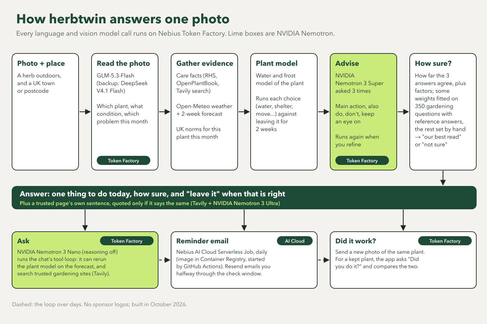
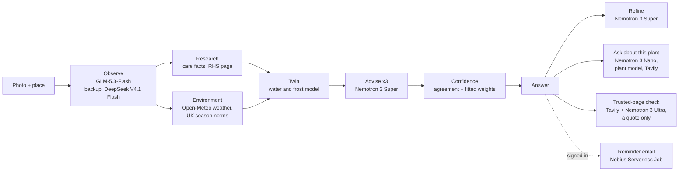

<p align="center"></p>

<h3 align="center">Is your herb thirsty, cold, or just having a bad month?</h3>

<p align="center">From one photo of a herb to the one thing to do now, tested first on the plant's twin.</p>

<p align="center">
  <a href="https://herbtwin.kashifnazir.com"><b>Live demo</b></a> ·
  <a href="https://youtu.be/7cybxZiDPuE"><b>3-min demo</b></a> ·
  <a href="https://devpost.com/software/herbtwin"><b>Devpost</b></a>
</p>

https://github.com/user-attachments/assets/978a2f3b-66b0-4d93-89af-a46f7a7d67f2

<p align="center">
  <a href="https://herbtwin.kashifnazir.com"></a>
</p>
<p align="center">
  <a href="docs/reference/nvidia-models.md"></a>
  <a href="#models-and-platform"></a>
  <a href="#models-and-platform"></a>
  <a href="pyproject.toml"></a>
  <a href="pyproject.toml"></a>
  <a href="tests"></a>
  <a href="LICENSE"></a>
</p>

**Nebius × NVIDIA Global AI Hackathon** · track: Best Apps and Agents · built solo,
October 2026 · submitted 26 Oct 2026

**Built with** NVIDIA Nemotron 3 Super, Nano and Ultra on Nebius Token Factory · Nebius AI
Cloud Serverless Job · Tavily · FastAPI

Send one photo of a herb and say where it is. herbtwin tells you the one thing to do now,
how sure it is, and when the right answer is to leave it alone. It is for UK gardeners
with herbs outdoors.

| Headline result | |
|---|---|
| Says "treat it" when the expert did not (150 expert questions) | **2%** with Nemotron 3 Super, against 12.7% with Ultra |
| False alarms from the photo check | **0** on 149 healthy plants |
| Chat answers right, with Tavily search vs without (30 questions) | **25 vs 15** |
| Cost of one example read: photo model + three Super asks (one read, not an average; trusted-page check not counted) | **$0.0040**, against about $0.0177 on Ultra |

<p align="center"></p>

### Try it in 60 seconds

1. Open **[herbtwin.kashifnazir.com](https://herbtwin.kashifnazir.com)**. No account needed.
2. Tap a sample photo, then **What does my plant need?** The answer usually arrives in
   under a minute, and the page shows each step as it runs.
3. Open **How we worked it out**: every choice compared, the sources, and **which model did
   each step**, with its time and cost.

Then ask a what-if ("what if I bring it in?"). Signed in, it emails you when it is time to
check, and your next photo asks "Did you do it?".

Judges: [JUDGES.md](JUDGES.md) has the five-minute tour and the known limits. No code is
needed: each visitor gets 30 photo reads a day.

## Why it's different

- **It tests before it advises.** A small water-and-frost model of the plant, its "twin",
  tries each choice (water, water lightly, move to shade or sun, bring in, leave it) over
  the next 14 days of your forecast, and the advisor gets the result as evidence.
- **Three advisors, one answer.** NVIDIA Nemotron 3 Super is asked three times, and how far
  the three agree sets how sure the answer is. Nemotron 3 Ultra, the largest, said "treat
  it" when the expert did not in 12.7% of answers against Super's 2%, so Ultra checks
  trusted gardening pages instead of deciding.
- **Every answer shows its bill.** Which model did each step, how long it took and what it
  cost, against the same work on Ultra. One example read cost $0.0040 against about
  $0.0177 on Ultra (Tavily searches and hosting not counted).
- **"Leave it" is an answer.** Of 774 expert answers on Stack Exchange, 150 say leave it
  and 66 say stop watering; only 37 say water. So herbtwin checks what is normal for the
  plant this month before it advises.

## How it works

One photo runs the whole chain with no person in it, and every model call goes through
one adapter over Token Factory's OpenAI-compatible API.



## Models and platform

| | Used for |
|---|---|
| **NVIDIA Nemotron 3 Super** | The advisor, asked three times per photo, and "Check the advice again" |
| **NVIDIA Nemotron 3 Nano** | The follow-up chat: it reruns the twin for a what-if and searches trusted sites |
| **NVIDIA Nemotron 3 Ultra** | The trusted-page check: it reads a page into a fixed form, code decides whether the page says the same as the answer, and a last Ultra check can only veto |
| **Nebius Token Factory** | Serves every language and vision model the app calls |
| **GLM-5.3-Flash, DeepSeek V4.1 Flash** | Read the photo (on Token Factory). GLM named the plant 0.846 of the time against 0.627 for the best NVIDIA vision model we tried |
| **Nebius AI Cloud** | The daily reminder emails as a Serverless Job; GPU jobs for the probes |
| **Nebius Object Storage** | A public, read-only mirror of the eval reports ([how it is published](docs/reference/eval-bucket-public.md)) |
| **Tavily** | The chat's search, the trusted-page search, and shops and local gardeners under the answer |

Which NVIDIA models we tried and why some lost: [docs/reference/nvidia-models.md](docs/reference/nvidia-models.md).

## Results

| What | Result |
|---|---|
| Healthy plants flagged with a problem | **0 of 149** |
| Says "treat it" when the expert did not (150 questions) | **Super 2%**, Ultra 12.7% |
| Names the species, top-1 (149 photos) | **0.846** |
| Confidence ranks right advice above wrong (AUROC, 624 held-out questions) | **0.63** |
| Chat answers right with Tavily search vs without (30 questions) | **25 vs 15**; re-checked 22 Oct: 26 vs 18 |

Every number, its interval and the command that reruns it:
[docs/reference/results.md](docs/reference/results.md). The reports are also mirrored on
Nebius Object Storage ([how it is published](docs/reference/eval-bucket-public.md)).

## Run it locally

Needs Python 3.12 and [uv](https://docs.astral.sh/uv/).

```sh
uv sync
cp .env.example .env
```

You need a Nebius Token Factory API key. In `.env`, set `HERBTWIN_BACKEND=tokenfactory`,
`HERBTWIN_NEBIUS_API_KEY`, and the models the live site uses:

```sh
HERBTWIN_OBSERVE_MODEL=zai-org/GLM-5.3-Flash
HERBTWIN_OBSERVE_FALLBACK_MODEL=deepseek-ai/DeepSeek-V4.1-Flash
HERBTWIN_ADVISE_MODEL=nvidia/nemotron-3-super-120b-a12b
HERBTWIN_FAST_MODEL=nvidia/NVIDIA-Nemotron-3-Nano-30B-A3B
HERBTWIN_NO_THINKING_MODELS=nvidia/NVIDIA-Nemotron-3-Nano-30B-A3B
```

The last two put the chat on Nemotron 3 Nano with reasoning off; leave them out and it
uses the advisor model.

Then:

```sh
uv run uvicorn herbtwin.web.app:create_app --factory --reload
```

and open http://localhost:8000 (the address `HERBTWIN_SITE_URL` expects). The default
backend, `mock`, is for the tests only and answers nothing on its own; `ollama` runs against local models. Everything else in
`.env.example` is optional: search (`HERBTWIN_SEARCH_ENABLED=1` plus a Tavily, Exa or
TinyFish key; Tavily also needs `HERBTWIN_TAVILY_ENABLED=1`), Supabase sign-in and
history, Resend email, the "What can I grow
here?" page (`HERBTWIN_SPOT_ENABLED=1`; switched off on the live site), LangSmith tracing,
and the site caps.

To run your own copy online: [docs/reference/deploy-your-own.md](docs/reference/deploy-your-own.md).

### Tests

```sh
uv run pytest -q                 # offline, no keys, no network
uv run pytest -q -m live         # real Token Factory calls (needs .env; costs cents)
                                 # and a sage photo of your own at data/photos/gate/sage.jpg
uv run pytest -q -m supabase     # needs a local Supabase (supabase start)
uv run ruff check . && uv run ruff format --check .
```

## Known limits

- **UK, outdoors, herbs.** Season norms are UK-only; the forecast test is for plants
  outside.
- **A photo is not a soil test.** Soil moisture is guessed from the surface; "Check the
  advice again" corrects it.
- **The photo model can be wrong about the species**, ferns especially; the answer says
  how sure it is.
- The live site runs one instance and caps reads per day; see [JUDGES.md](JUDGES.md#5-known-limits).

## More

- **The story**, what didn't work and what's next: the site's [About page](https://herbtwin.kashifnazir.com/about).
- **Architecture:** the full models table, the GPU probes and where each part of the code
  lives: [docs/reference/architecture.md](docs/reference/architecture.md).
- **Accessibility:** checked with axe-core (WCAG 2.0 to 2.2, A and AA), keyboard focus and
  320 px reflow: [docs/reference/accessibility.md](docs/reference/accessibility.md).
- **Data and licences:** [docs/reference/data-and-licences.md](docs/reference/data-and-licences.md) and [NOTICE](NOTICE).

## Licence

MIT for the code: see [LICENSE](LICENSE). Data licences are in
[docs/reference/data-and-licences.md](docs/reference/data-and-licences.md).
