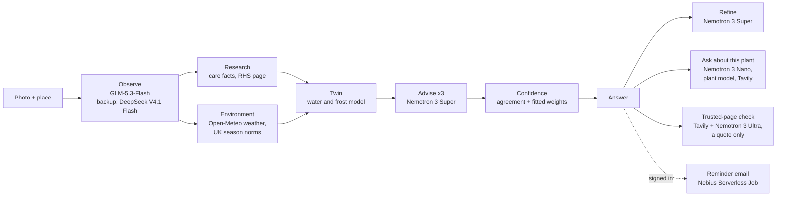

<!--
Screenshots to add when the design is final (Kash, 22 Oct: not yet). Put the files in
docs/screenshots/ and use markdown images with a long, descriptive alt text.

1. Hero, under the live link: the answer page for a sample photo, headline first
   ("Leave it. This is normal for October"), how sure it is, and the What next card.
   A short GIF of a read (home, sample tap, wait screen, answer) could replace it.
2. "What it does", beside step 2: the wait screen mid-read: steps as they happen, the
   model named on each, the twin's verdicts and "Advisor 2 of 3".
3. "What it costs to run": the answer's "Which model did each step" receipt, with its
   all-Ultra estimate.
4. "Where it came from": the About page.
5. "What it does", last paragraph: the "What can I grow here?" spot page for the raised
   bed sample (Good now, Worth a try, Coming up; sun hours; soil).

Video slots, as link lines under the live link:
- 30-second demo: **Watch it in 30 seconds:** <URL>
- 3-minute Devpost video: **The 3-minute tour:** <URL>
-->

# herbtwin

Is your herb thirsty, cold, or just having a bad month? Send one photo and a place, and
herbtwin tells you the one thing to do now and how sure it is. Sometimes the right
answer is to leave it alone. It is built for UK gardeners with herbs outdoors.

**[Open the site →](https://herbtwin.kashifnazir.com)** No account needed: tap a sample
photo, and the answer arrives in about 15 to 35 seconds.

Built solo in October 2026 for the Nebius × NVIDIA Global AI Hackathon, with NVIDIA
Nemotron 3 Super, Nano and Ultra on Nebius Token Factory. Judges: start with
[JUDGES.md](JUDGES.md) (what to try in five minutes, the sample photos, known limits).
The judges' code is in the submission form, not in this repo.

## What it does

1. **Reads the photo**: which plant, what condition (droop, yellowing, pests, flowering),
   and where and when it was taken, if the photo says.
2. **Gathers evidence**: the plant's care facts (and its RHS page for a plant outside the
   built-in list), the weather and a 2-week forecast for the place, what is normal for
   that plant in that UK month, and a small water and frost model of the plant (the
   "twin").
3. **Advises, action first**: one main action (or "leave it, this is normal now"), what
   else to do, what not to do and what to watch, with what happens if you do each thing.
   The reasons and evidence sit below, folded.
4. **Says how sure it is**: two levels, each with what it matched in a test on 624
   held-out expert questions: "our best read, about half the time" (0.51) or "not sure,
   check first, about 1 in 3" (0.31), and what would make it surer. A rough read (a poor
   photo the plant can't be named from) is never "our best read".

After the answer you can **refine** ("the soil is damp 2 cm down") and the advice is
checked again, or **ask** a what-if ("what if I move it inside?"), answered by running
the plant model and, when it helps, by searching trusted gardening sites with Tavily.
Signed in, answers are kept per plant, a later photo asks "Did you do it?", and a
reminder email can be sent when it is time to check again. **What can I grow here?**
reads a photo of a bed or pot and suggests crops for that spot and month.

## Decisions worth explaining

**Super decides because the biggest model was the keenest to treat.** On 150 expert
questions, Nemotron 3 Ultra told people to treat a plant when the expert did not in
12.7% of answers; Super did in 2%, and matched the expert's main action as often or
better. So Super writes the advice, asked three times, and Ultra got the job it passed a
pre-registered test for: checking whether a trusted gardening page says the same.

**Every choice is tried on a twin before the advice is written.** The twin is a small
water and frost model of the plant: code rolls six choices (water, water lightly, shade,
sun, bring in, leave it) over the next 14 days of forecast, and the advisor gets the
result as evidence. On 120 scripted cases, Super took the twin's better choice on the
risky ones in 84 of 84 answers with the twin and 78 of 84 without.

**"Leave it" is an answer.** Of 774 expert answers on Stack Exchange, 150 say leave it,
it's normal, and 66 say stop watering; only 37 say water. An app that always finds
something to fix is wrong exactly where it costs a plant, so herbtwin checks what is
normal for the month before it advises.

**The confidence says what it measured.** A professional gardener called our old "7 in
10" overstated. A pre-registered test on 624 held-out questions agreed (it matched the
expert 51% of the time), so the answer now says "our best read, about half the time" or
"not sure, check first, about 1 in 3".

**A non-NVIDIA model reads the photo, because it measured better.** Four NVIDIA vision
models named the plant 0.54 to 0.63 of the time against GLM-5.3-Flash's 0.85 to 0.87, so
GLM reads the photo and Nemotron does the reasoning and the talking. What failed is kept
and published: [docs/reference/nvidia-models.md](docs/reference/nvidia-models.md) and the
[What didn't work](https://herbtwin.kashifnazir.com/about#didnt) on the site's About page.

## Where the AI is

| Piece | Used for |
|---|---|
| **NVIDIA Nemotron 3 Super** (`nvidia/nemotron-3-super-120b-a12b`) | The advisor (three asks per read) and refine |
| **NVIDIA Nemotron 3 Nano** (`nvidia/NVIDIA-Nemotron-3-Nano-30B-A3B`, reasoning off) | The follow-up chat's tool loop ("what if I water it?" runs the plant model): 10/10 on the what-if check, about twice as fast as Super ([docs/reference/chat-on-nano.md](docs/reference/chat-on-nano.md)) |
| **NVIDIA Nemotron 3 Ultra** (`nvidia/Nemotron-3-Ultra-550b-a55b`, thinking off) | The trusted-page check: it reads each sentence of a trusted gardening page found with Tavily into a fixed form, and code decides whether the page says the same as the answer. If so, the answer quotes the sentence; confidence never changes. 0 of 191 false agrees on real pages (pre-registered, 19 Oct) |
| **Nebius Token Factory** | Serves every language and vision model the app calls (Nemotron, GLM, DeepSeek), through its OpenAI-compatible API. One dedicated endpoint (1x H100, about $0.60) was used to test Nemotron 3 Nano Omni on our photos |
| **GLM-5.3-Flash / DeepSeek V4.1 Flash** (on Token Factory, not NVIDIA models) | Reading the photo, the problem check, and comparing two photos for "Did you do it?". GLM names the plant better than every NVIDIA vision model we tested, including Nemotron 3.5 Super VL on Token Factory (0.846 against 0.627), so GLM reads photos, with DeepSeek as the backup when GLM fails or is slow |
| **Nebius AI Cloud Serverless Jobs** | The daily reminder job, started by GitHub Actions from an image in Nebius Container Registry, with its keys from a Nebius MysteryBox secret ([docs/REMINDERS.md](docs/REMINDERS.md)). GPU jobs also rendered the eight "in about a week" pictures (Qwen-Image-Edit) and ran three NVIDIA probes: Cosmos Reason on the photo step, a LoRA-tuned Nemotron 3 Nano 4B as the advisor, and Nemotron 3 Nano self-hosted with vLLM, which agreed with Token Factory on 81% of answers (passing the pre-registered bar) but scored slightly worse against the expert answers ([report](data/eval/reports/2026-10-19-nano-selfhost.md)) |
| **Nebius Object Storage** | A public, read-only mirror of the evaluation reports and labelled sets, so a judge can fetch any number's report without the repo ([docs/reference/eval-bucket-public.md](docs/reference/eval-bucket-public.md)) |
| **Tavily** | The chat's web search (trusted gardening sites only), the trusted-page check's search, a fallback for finding a plant's RHS page, and two shortcuts under the answer: shops for what it asks you to do, and gardeners near a town you typed |

Also tested and not used live (details in
[docs/reference/nvidia-models.md](docs/reference/nvidia-models.md)): Nemotron 3 Ultra as
the advisor (above); Nemotron 3.5 Lightning for the chat, which flooded tool calls; and a
LoRA-tuned Nemotron 3 Nano 4B, inside the noise of Super but needing an always-on GPU to
serve.

## Architecture

One photo runs the whole chain with no person in it. Every model call goes through one
adapter over Token Factory's OpenAI-compatible API, so a model is one id in config.



The advisor is asked the same question three times; how far the three answers agree is
one input to the confidence score. The page streams each step as it happens, and names the
model on the photo and advisor steps, so a read never looks stuck.

The site runs on Google Cloud Run (London) behind Cloudflare. Accounts and history are in
Supabase; sign-in and reminder emails go through Resend. Tracing is LangSmith.

## What it costs to run

Each answer shows its own bill under "How we worked it out": which model did each step,
how long it took and what it cost, against an estimate of the same tokens on Nemotron 3
Ultra. One example read (run locally, without the trusted-page check) cost $0.0040 in
model time: $0.0016 for GLM-5.3-Flash to read the photo and $0.0024 for Super's three
asks, against about $0.0177 on Ultra. Tavily searches and hosting are not in that figure.

The live site has daily read caps per visitor and a total model budget, counted in
Supabase. The reminder job costs under a cent a day as a Nebius Serverless Job.

Where Token Factory sped the work up:

- **Paid evals cost cents, so the species and advice rates below carry 95% bootstrap
  intervals.** 696 photos (513 public, 183 from our own garden) through GLM cost $0.44 in total. A 150 to 200 question
  advice run on Nemotron 3 Super with one ask each took 2 to 6 minutes (8 workers) and
  about $0.08 to $0.19 on the early prompts; with three asks each it cost $0.37 and
  $0.50, so the full run over both sets (350 questions) cost $0.87.
  The same runs on a local 14B model took hours and scored lower (0.283 on all 774
  Stack Exchange questions against Super's 0.387 on 150 of them, both on the 4 Oct prompt).
- **A model is one id in `.env`.** The API is OpenAI-compatible, so the `openai` SDK with
  a `base_url` covers every model. On day one we compared five vision models on our own
  photos by changing the model id. When GLM went quiet on 13 Oct we scored four backups on the
  same 150 photos the same evening (DeepSeek V4.1 Flash won: 0.799 on the 144 photos scored; its run cost $0.44) and
  switched the live backup by id. Moving the chat from Super to Nano was the same kind of
  change, after a 10-case check that cost about $0.07.
- **One bill for the whole chain.** The photo read, the problem check, the three
  advisor asks and the chat all go through one Token Factory key, so a
  free public demo needed only a daily cap and one budget stop.

## Running it

Needs Python 3.12 and [uv](https://docs.astral.sh/uv/).

```sh
uv sync
cp .env.example .env
```

You need a Nebius Token Factory API key. In `.env`, set `HERBTWIN_BACKEND=tokenfactory`,
`HERBTWIN_NEBIUS_API_KEY`, and the models the live site uses:

```sh
HERBTWIN_OBSERVE_MODEL=zai-org/GLM-5.3-Flash
HERBTWIN_OBSERVE_FALLBACK_MODEL=deepseek-ai/DeepSeek-V4.1-Flash
HERBTWIN_ADVISE_MODEL=nvidia/nemotron-3-super-120b-a12b
HERBTWIN_FAST_MODEL=nvidia/NVIDIA-Nemotron-3-Nano-30B-A3B
HERBTWIN_NO_THINKING_MODELS=nvidia/NVIDIA-Nemotron-3-Nano-30B-A3B
```

The last two put the chat on Nemotron 3 Nano with reasoning off; leave them out and it
uses the advisor model.

Then:

```sh
uv run uvicorn herbtwin.web.app:create_app --factory --reload
```

and open http://localhost:8000 (the address `HERBTWIN_SITE_URL` expects). The default
backend, `mock`, is for the tests only and answers nothing on its own; `ollama` runs against local models. Everything else in
`.env.example` is optional: search (`HERBTWIN_SEARCH_ENABLED=1` plus a Tavily, Exa or
TinyFish key; Tavily also needs `HERBTWIN_TAVILY_ENABLED=1`), Supabase sign-in and
history, Resend email, "What can I grow
here?" (`HERBTWIN_SPOT_ENABLED=1`), LangSmith tracing, and the site caps.

### Deploying your own copy

The live site's own deploy files (its domain, cloud project and registry ids) are not
in this repo. To run your own copy online:

1. **Image.** The `Dockerfile` builds the app with its data; `.gcloudignore` keeps a
   Cloud Build upload to what the image needs. Any container host works. We use Google
   Cloud Run: `gcloud run deploy herbtwin --source . --region <region> --port 8000`.
   One always-on instance (`--min-instances 1 --max-instances 1`, 1 vCPU, 1 GiB) keeps
   answers in memory between requests.
2. **Settings.** Set the same `HERBTWIN_*` values as `.env` (`.env.example` lists them)
   as service settings, and keep the keys in a secret store, never in the image. For a
   public site also set `HERBTWIN_SITE_URL`, `HERBTWIN_CAPS_ENABLED=1` and a
   `HERBTWIN_JUDGE_CODE` if you want a code that skips the caps.
3. **Caps and accounts.** The daily read caps and the model budget count in Supabase:
   run `supabase db push` with `supabase/migrations/` against your project
   ([docs/SUPABASE.md](docs/SUPABASE.md)). `/health` should then say `"usage": "ok"`.
4. **Edge (optional).** `edge/src/index.js` is a Cloudflare Worker that adds a shared
   secret header and the visitor's IP; with `HERBTWIN_EDGE_SECRET` set, the app refuses
   requests that skip it. Write your own `wrangler.toml` with your route and
   `ORIGIN` (your Cloud Run address), then `npx wrangler deploy` and
   `npx wrangler secret put EDGE_SECRET`.
5. **Reminder emails (optional).** `python -m herbtwin.reminders` sends the day's
   re-photo emails and exits. We run it once a day as a Nebius Serverless Job, started by
   a scheduled GitHub Actions workflow. That workflow file is not in this repo (it names
   our registry and project); it does four things: installs the Nebius CLI, signs in as
   a service account from repository secrets, builds the image on GitHub with BuildKit
   (`linux/amd64`, `provenance: false`) and pushes it to Nebius Container Registry, then
   runs `nebius ai job create --image <your image> --container-command python --args
   "-m herbtwin.reminders" --platform cpu-d3 --preset 2vcpu-8gb --timeout 1h`, with the
   four keys from a MysteryBox secret (`--env-secret`), and waits for the job to finish.
   What the job does and needs: [docs/REMINDERS.md](docs/REMINDERS.md).

### Tests

```sh
uv run pytest -q                 # offline, no keys, no network
uv run pytest -q -m live         # real Token Factory calls (needs .env; costs cents)
                                 # and a sage photo of your own at data/photos/gate/sage.jpg
uv run pytest -q -m supabase     # needs a local Supabase (supabase start)
uv run ruff check . && uv run ruff format --check .
```

## Evaluation

The rates carry 95% bootstrap intervals; the AUROC is one held-out value. Full reports,
with ids and labels but no answer text: [data/eval/reports/](data/eval/reports/README.md).
The same public reports and sets are also mirrored, read-only, on Nebius Object Storage at
`https://storage.uk-south1.nebius.cloud/herbtwin-public-eval/<path below data/eval/>`, for example
[reports/README.md](https://storage.uk-south1.nebius.cloud/herbtwin-public-eval/reports/README.md)
([how it is published](docs/reference/eval-bucket-public.md)). Results that failed are kept
too: the models we tested and dropped are in
[docs/reference/nvidia-models.md](docs/reference/nvidia-models.md), and the reports
directory holds the failed pre-registered rounds beside the passing ones.

| What | Set | Result |
|---|---|---|
| Photo: species, top-1 (GLM-5.3-Flash, live prompt) | 150 GBIF/iNaturalist photos, 15 taxa (149 scored) | **0.846** [0.785, 0.899]; top-3 0.933 (`2026-10-16-species_gbif-glm-5-3-flash-scene`) |
| Photo: is it declining? (balanced accuracy, live prompt) | 120 indoor-leaf photos | **0.900** [0.842, 0.950] (`2026-10-17-decline_indoor-glm-5-3-flash-scene`) |
| Advice: main action matches the expert's (Nemotron 3 Super, 3 asks) | 150 Stack Exchange questions | **0.427** [0.347, 0.500] (`b1b-se-150`) |
| Advice: same | 200 MIRAGE plant-care questions | **0.410** [0.340, 0.475] (`b1b-mirage`) |
| Confidence: separates right from wrong main actions (AUROC on held-out cases: 624 Stack Exchange questions the weights were never fitted on, live advisor, reported alongside the pre-registered levels test, 19 Oct) | `actions_se` | **0.63** (0.74 was the 5 Oct cross-fit on the same 350 questions: fit on one set, scored on the other) |
| The twin: does the advisor take the twin's better choice? (Nemotron 3 Super's panel, twin on vs off) | 120 scripted cases, 42 with a risky day | Risky cases: **84 of 84** answers with the twin, **78 of 84** without; 4 of the 42 cases moved to the twin's choice, none the other way (p = 0.125). Pre-registered overall measure: no change, **+0.013** [−0.025, +0.054]. Over-treated a healthy plant: 0 of 240 in each arm (`2026-10-18-twin-at-scale`) |
| Chat: does Tavily search make the answer right? (Nemotron 3 Nano, search on vs off) | 30 factual herb questions | **25 of 30** right with search, **15 of 30** without: **+0.333** [+0.133, +0.533], pre-registered (`2026-10-19-chat-search`) |

The two advice rows are three asks on the 5 Oct prompt. On the live prompt, asked once,
Super scores 0.440 [0.360, 0.520] and 0.435 [0.365, 0.505] (`super-se-150-p7ba`,
`super-mirage-p7ba`).

How to read the advice rows: the expert's main action was extracted from free-text
answers, and a hand check agreed with that extraction about 80% of the time, so 0.8 is
roughly the ceiling. In about a fifth of expert answers the right advice is "leave it,
this is normal", which is why the app can say so.

How to read the twin row: the right answer in that test is the twin's own better choice,
so it shows the advisor follows the twin's forecast, not that the twin is right.

How to read the chat row: most of the gap is the chat without search saying it is not
sure (17 of 30). A stricter marking scheme, written after reading the replies, gives
+0.50; it is a check, not the result.

### Rerun a number

Each command is the one the report was made with; run it from the commit the report
names (the reports record it). Every paid script quotes its cost and stops at a budget;
it spends nothing without `--yes-paid`, and `--dry-run` shows the quote only. Paid runs
need `HERBTWIN_NEBIUS_API_KEY` (and the chat test a Tavily key) in `.env`. The photo and
advice sets hold ids and labels only; the photos and question texts they point to are
not shipped and are read from `data/external/` (`scripts/build_eval_sets.py` documents
the layout). The twin and chat tests need no external datasets.

| Number | Command | Cost, about |
|---|---|---|
| Species 0.846 | `uv run python scripts/eval.py --set species_gbif --backend tokenfactory --model zai-org/GLM-5.3-Flash --yes-paid` | $0.13 |
| Declining 0.900 | the same with `--set decline_indoor` | $0.10 |
| Advice 0.427 | `uv run python scripts/eval_advice.py --set actions_se --model nvidia/nemotron-3-super-120b-a12b --backend tokenfactory --asks 3 --limit 150 --workers 8 --yes-paid` (at `f0b841c`) | $0.37 |
| Advice 0.410 | `uv run --with pyarrow python scripts/eval_advice.py --set actions_mirage --model nvidia/nemotron-3-super-120b-a12b --backend tokenfactory --asks 3 --workers 8 --yes-paid` (at `f0b841c`) | $0.50 |
| Advice 0.440 / 0.435 (live prompt) | the two commands above with `--asks 1`, at the current commit | $0.41 / $0.55 |
| Confidence 0.63 | `uv run python scripts/eval_advice.py --set actions_se --model nvidia/nemotron-3-super-120b-a12b --backend tokenfactory --asks 3 --run-id super-se774-p7ba`, then the shipped `data/confidence/weights.json` and cut points on the 624 questions not in the 5 Oct fit (rows not shipped) | about $2.14 |
| Twin 84 of 84 | `uv run python scripts/eval_twin_at_scale.py --repeats 2 --budget 4 --yes-paid` (at `617a435`) | $1.93 |
| Chat search 25 of 30 | `uv run python scripts/measure_chat_search.py --budget 3 --yes-paid` (at `f5eb9aa`; `--rescore` re-marks saved rows for free) | $0.01 model + $0.26 Tavily |

## Data and licences

| Data | Source | Licence |
|---|---|---|
| Herb care facts (`src/herbtwin/data/openplantdb_herbs.json`) | OpenPlantDB | CC0 1.0 |
| UK season norms (`data/seasonal/`) | Written for this project; each row cites RHS, NC State or other extension pages | MIT, with sources per row |
| Outcomes, "what happens if you do it" (`data/outcomes/`) | Paraphrased facts, each row citing its RHS or extension page | MIT, with sources per row |
| Crop calendar (`data/crop_calendar/`) | RHS, Garden Organic and seed-company pages per row, plus the [Plant Variety Database](https://github.com/bripatch/plant-variety-database) | Plant Variety Database: CC BY 4.0 |
| 1 km soil, frost and sun grid (`data/spot_grid/`) | BGS, UKCEH, Met Office HadUK-Grid | Open Government Licence ([credits](data/spot_grid/README.md)) |
| Sample photos (`docs/judges/samples/`, and copies with thumbnails in `src/herbtwin/web/static/samples/`) | iNaturalist, Wikimedia Commons | CC0 / CC BY ([credits](docs/judges/samples/CREDITS.md)) |
| "In about a week" pictures (`src/herbtwin/web/static/twin/`) | Edits of four sample photos, made with Qwen-Image-Edit-2509 (Apache-2.0) | Each keeps its source photo's licence; credit per picture in `manifest.json` |
| Plant name synonyms (`src/herbtwin/evals/species_synonyms.json`) | Kew World Checklist of Vascular Plants (WCVP) v16 | CC BY 3.0 |
| Eval sets (`data/eval/sets/`) | Stack Exchange Gardening, GBIF and others | ids and labels only; per-row source and licence |

Fetched live, not stored here: weather and place names from Open-Meteo (CC BY 4.0; its
free API is for non-commercial use), UK postcodes from postcodes.io (OS OpenData and
ONSPD), care bands from OpenPlantBook (its own terms), and RHS plant pages and search
results (publishers' copyright, linked, not copied). Full credits: [NOTICE](NOTICE).
Python dependencies are MIT, BSD or Apache-2.0.

## Accessibility

Checked on 21 Oct with axe-core (WCAG 2.0 to 2.2, A and AA) on the home, wait, answer
and spot pages, light and dark, at 390 px. One miss: the dark-mode "(optional)" by
"Where is it?" at 3.98:1, now 5.4:1, with a test. Every stop in a keyboard walk of the
home page shows a focus ring; nothing but inline credit and licence links is under
44 px; the pages reflow at 320 px with no sideways scroll; the page motion is off under
Reduce Motion. Not yet done: a test with a real screen reader.

## Known limits

- **UK, outdoors, herbs.** Season norms are UK-only; the weather and forecast are for
  plants outside. Indoor light is not measured.
- **A photo is not a soil test.** Soil moisture is guessed from the surface; refine
  corrects it.
- **The photo model can be wrong about the species**, ferns especially; the answer says
  how sure it is.
- The live site runs one instance and caps reads per day; see [JUDGES.md](JUDGES.md#5-known-limits).

## Where to look

If you're reading the code, the parts worth your time:

- `src/herbtwin/pipeline.py` — the chain: runs the stages, streams each step, and keeps
  going when one fails.
- `src/herbtwin/stages/` — one file per step: `observe.py` (the photo), `research.py`
  (care facts, the RHS page), `environment.py` (weather), `twin.py` with
  `plant_model.py` (the twin), `advise.py` (the three asks), `trusted_page.py` and
  `trusted_check.py` (Ultra reads, code decides).
- `src/herbtwin/confidence.py` — how sure it is, from agreement and fitted weights.
- `src/herbtwin/receipt.py` — each answer's model, time and cost per step.
- `src/herbtwin/adapters/` — the one seam every model call goes through.
- `src/herbtwin/web/` — the FastAPI site and its templates.
- `scripts/` and `data/eval/` — the eval runners and every report behind a number above.
- `tests/` — offline tests; live and Supabase tests are opt-in markers.

## Where it came from

I attended the Nebius × NVIDIA event at Builders & Brews London, and built herbtwin on
my own in October 2026. It started in my own garden: herbs in a trough and pots. This
autumn the oregano died and the purple sage nearly did, and I couldn't tell what was
normal for October. A professional gardener graded its advice, and a former tree surgeon
tried it over the phone; what they said changed it. The full story is on the site's
[About page](https://herbtwin.kashifnazir.com/about).

## Licence

MIT for the code: see [LICENSE](LICENSE). Data licences and credits are listed above and
in [NOTICE](NOTICE).
