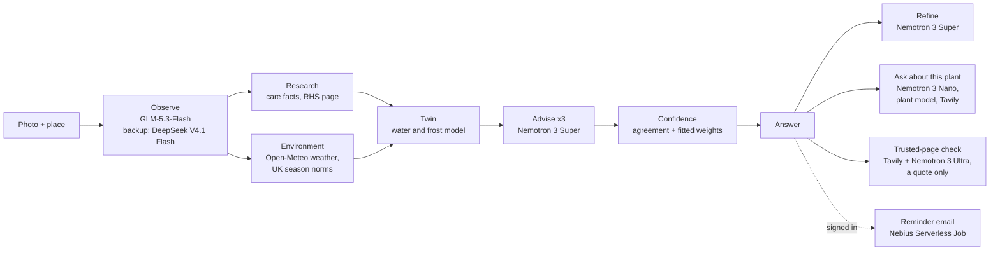

# Architecture

How herbtwin is put together: the chain one photo runs, which model or service does each
step, and where the code for each part lives. The short version is in the
[README](../../README.md).

One photo runs the whole chain with no person in it. Every model call goes through one
adapter over Token Factory's OpenAI-compatible API, so a model is one id in config.

The advisor is asked the same question three times; how far the three answers agree is
one input to the confidence score. The page streams each step as it happens, and names the
model on the photo and advisor steps, so a read never looks stuck.

The site runs on Google Cloud Run (London) behind Cloudflare. Accounts and history are in
Supabase; sign-in and reminder emails go through Resend. Tracing is LangSmith.

## Which model does what

| Piece | Used for |
|---|---|
| **NVIDIA Nemotron 3 Super** (`nvidia/nemotron-3-super-120b-a12b`) | The advisor (three asks per read) and refine |
| **NVIDIA Nemotron 3 Nano** (`nvidia/NVIDIA-Nemotron-3-Nano-30B-A3B`, reasoning off) | The follow-up chat's tool loop ("what if I water it?" runs the plant model): 10/10 on the what-if check, about twice as fast as Super ([docs/reference/chat-on-nano.md](chat-on-nano.md)) |
| **NVIDIA Nemotron 3 Ultra** (`nvidia/Nemotron-3-Ultra-550b-a55b`, thinking off) | The trusted-page check: it reads each sentence of a trusted gardening page found with Tavily into a fixed form, and code decides whether the page says the same as the answer; a last Ultra check, shown the advice, can only take an agree away. If both pass, the answer quotes the sentence; confidence never changes. Round 8 on real pages (pre-registered, 22 Oct): 3 of 418 false agrees, upper bound 2.09%; 10 of 26 good quotes found |
| **Nebius Token Factory** | Serves every language and vision model the app calls (Nemotron, GLM, DeepSeek), through its OpenAI-compatible API. One dedicated endpoint (1x H100, about $0.60) was used to test Nemotron 3 Nano Omni on our photos |
| **GLM-5.3-Flash / DeepSeek V4.1 Flash** (on Token Factory, not NVIDIA models) | Reading the photo, the problem check, and comparing two photos for "Did you do it?". GLM names the plant better than every NVIDIA vision model we tested, including Nemotron 3.5 Super VL on Token Factory (0.846 against 0.627), so GLM reads photos, with DeepSeek as the backup when GLM fails or is slow |
| **Nebius AI Cloud Serverless Jobs** | The daily reminder job, started by GitHub Actions from an image in Nebius Container Registry, with its keys from a Nebius MysteryBox secret ([docs/REMINDERS.md](../REMINDERS.md)). GPU jobs also rendered the eight "in about a week" pictures (Qwen-Image-Edit) and ran three NVIDIA probes: Cosmos Reason on the photo step, a LoRA-tuned Nemotron 3 Nano 4B as the advisor, and Nemotron 3 Nano self-hosted with vLLM, which agreed with Token Factory on 81% of answers (passing the pre-registered bar) but scored slightly worse against the expert answers ([report](../../data/eval/reports/2026-10-19-nano-selfhost.md)) |
| **Nebius Object Storage** | A public, read-only mirror of the evaluation reports and labelled sets, so a judge can fetch any number's report without the repo ([docs/reference/eval-bucket-public.md](eval-bucket-public.md)) |
| **Tavily** | The chat's web search (trusted gardening sites only), the trusted-page check's search, a fallback for finding a plant's RHS page, and two shortcuts under the answer: shops for what it asks you to do, and gardeners near a town you typed |

Also tested and not used live (details in
[docs/reference/nvidia-models.md](nvidia-models.md)): Nemotron 3 Ultra as
the advisor (above); Nemotron 3.5 Lightning for the chat, which flooded tool calls; and a
LoRA-tuned Nemotron 3 Nano 4B, inside the noise of Super but needing an always-on GPU to
serve.

## Where to look in the code

If you're reading the code, the parts worth your time:

- `src/herbtwin/pipeline.py` — the chain: runs the stages, streams each step, and keeps
  going when one fails.
- `src/herbtwin/stages/` — one file per step: `observe.py` (the photo), `research.py`
  (care facts, the RHS page), `environment.py` (weather), `twin.py` with
  `plant_model.py` (the twin), `advise.py` (the three asks), `trusted_page.py` and
  `trusted_check.py` (Ultra reads, code decides).
- `src/herbtwin/confidence.py` — how sure it is, from agreement and fitted weights.
- `src/herbtwin/receipt.py` — each answer's model, time and cost per step.
- `src/herbtwin/adapters/` — the one seam every model call goes through.
- `src/herbtwin/web/` — the FastAPI site and its templates.
- `scripts/` and `data/eval/` — the eval runners and every report behind a number above.
- `tests/` — offline tests; live and Supabase tests are opt-in markers.
